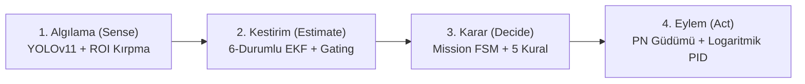

# Otonom Zeki Sistemler Yüksek Lisans Proje Raporu

---

## 📌 Proje Bilgileri
* **Ders:** Otonom Zeki Sistemler (OZS)
* **Proje Konusu:** Otonom Hava Muharebesinde Görsel Takip, Genişletilmiş Kalman Filtresi ile Durum Kestirimi ve Oransal Seyrüsefer Güdümü
* **Uygulama Platformu:** VTOL (Vertical Take-Off and Landing - QuadPlane) İHA
* **Simülasyon & Yazılım Altyapısı:** ArduPilot SITL, ROS Noetic, Gazebo, OpenCV, YOLOv11, PyTorch

---

## 1. Giriş ve Problem Tanımı

Otonom hava muharebesi (Air-to-Air Combat / Dogfight), hava araçlarının yüksek hız, 3 boyutlu dinamik kısıtlar ve sensör gürültüleri altında birbirini tespit edip takip etmesini gerektiren en zorlu otonom sistem problemlerinden biridir.

Bu projede; bir Avcı İHA'nın (Hunter), gökyüzünde manevra yapan bir Av İHA'yı (Prey) ön kamera görüntüsü üzerinden tespit edip arkasına güvenli mesafeyle yerleşmesi ve şartnamede belirlenen 5 kilitlenme kriterini kesintisiz **4.0 saniye** boyunca sağlayarak otonom kilitlenme gerçekleştirmesi hedeflenmiştir.

### Temel Zorluklar (Challenges):
1. **Görsel Gürültü ve Hedef Kayıpları:** Derin öğrenme (YOLO) tespitleri ışık parlaması, açı değişimi veya titreşim nedeniyle anlık olarak kesintiye uğrayabilir.
2. **Doğrusal Olmayan Dinamikler:** İHA'lar aynı irtifada uçarken arkadan bakışta kesit alanı çok daralır ve derinlik (menzil) algısı monoküler kamerada zorlaşır.
3. **Kaçış Manevraları:** Manevra yapan hedeflere karşı klasik takip (Pure Pursuit) kontrolcüleri viraj dışına savrularak hedefi kadrajdan kaçırır.

---

## 2. Sistem Mimarisi

Sistem, otonom robotik döngüsünün 4 ana katmanını barındırır:

---

## 3. Matematiksel Modelleme ve Algoritmalar

### 3.1. Genişletilmiş Kalman Filtresi (EKF) Takipçisi
Kamera görüntüsündeki gürültüyü süzmek ve hedef 1-2 kare görünmediğinde (occlusion/coasting) yerini tahmin etmek amacıyla **6-durumlu Tek Hedefli EKF** tasarlanmıştır:

$$\mathbf{x} = \begin{bmatrix} c_x & c_y & v_x & v_y & w & h \end{bmatrix}^T$$

* $(c_x, c_y)$: Hedefin piksel merkez koordinatları
* $(v_x, v_y)$: Piksel hız vektörü
* $(w, h)$: Hedef sınırlayıcı kutu (bounding box) boyutları

#### Tahmin Adımı (Predict):
$$\mathbf{x}_{k|k-1} = \mathbf{F} \mathbf{x}_{k-1|k-1}, \quad \mathbf{P}_{k|k-1} = \mathbf{F} \mathbf{P}_{k-1|k-1} \mathbf{F}^T + \mathbf{Q}$$

$$\mathbf{F} = \begin{bmatrix} 
1 & 0 & \Delta t & 0 & 0 & 0 \\
0 & 1 & 0 & \Delta t & 0 & 0 \\
0 & 0 & 1 & 0 & 0 & 0 \\
0 & 0 & 0 & 1 & 0 & 0 \\
0 & 0 & 0 & 0 & 1 & 0 \\
0 & 0 & 0 & 0 & 0 & 1 
\end{bmatrix}$$

#### Mahalanobis Mesafe Eşikleme (Gating):
Yanlış pozitifleri (kuş, bulut, parlama) reddetmek için ölçüm uzayında gating uygulanır:
$$d_M^2 = (\mathbf{z} - \mathbf{H}\mathbf{x})^T \mathbf{S}^{-1} (\mathbf{z} - \mathbf{H}\mathbf{x}) \leq \gamma_{gate}$$

---

### 3.2. Oransal Seyrüsefer (Proportional Navigation - PN) Güdümü
Klasik hedef arkası kovalamacası (Pure Pursuit) yerine, hava-hava füzelerinde kullanılan **Proportional Navigation (PN)** güdüm kanunu entegre edilmiştir.

Görüş Hattı Dönüş Hızı (Line-of-Sight Angular Rate):
$$\dot{\lambda} = \frac{\theta_{LOS}(t) - \theta_{LOS}(t - \Delta t)}{\Delta t}$$

Komuta Edilen Yönelim İvmesi:
$$a_c = N \cdot V_c \cdot \dot{\lambda}$$

* $N$: Navigasyon sabiti ($N = 3.2$)
* $V_c$: Yaklaşma hızı (Closing velocity)
* Üretilen açısal hız komutu: $\omega_{yaw} = \frac{a_c}{V_{airspeed}}$

Bu sayede avcı İHA hedefin arkasına değil, hedefin virajdaki geleceği önleme noktasına doğru kesme atar.

---

### 3.3. Logaritmik Mesafe Kontrolü
Monoküler kamerada derinlik algısı hedef genişlik oranı ($r = w / W_{frame}$) üzerinden sağlanır. Optik perspektifin doğrusal olmayan yapısını pürüzsüzleştirmek için logaritmik hata formülasyonu kullanılmıştır:

$$e_{dist} = \ln\left(\frac{r_{hedef}}{r_{mevcut}}\right)$$

$$V_{forward} = K_p e_{dist} + K_i \int e_{dist} dt + K_d \frac{de_{dist}}{dt}$$

---

### 3.4. Akıllı Kaçış Algoritması (Evader AI / Pursuit-Evasion)
Av İHA'ya eklenen tehdit algılama mekanizması:
1. $d_{rel} < 85\,\text{m}$ ve avcı avın arka konisi ($\pm 70^\circ$) içerisindeyse kaçış başlar.
2. **S-Turn Kaçışı:** Avcının 4.0 saniye kilit sayacını sıfırlamak için $\pm 45^\circ$ periyodik zikzaklar atar.
3. **Dikey İrtifa Kaçışı:** Avcının dar dikey FOV'undan ($75^\circ$) çıkmak için ani $\pm 20\,\text{m}$ irtifa değiştirir.
4. **Break Turn:** $85^\circ$ keskin viraj ile avcının arkasından kurtulur.

---

## 4. Şartname Kilitlenme Kuralları

Başarılı bir kilitlenme için aşağıdaki 5 şart aynı anda **4.0 saniye kesintisiz** sağlanmalıdır:

| Kriter No | Kural Adı | Şartname Eşiği | Açıklama |
| :---: | :--- | :---: | :--- |
| **1** | Hedef Boyutu | $\ge \%5$ | Ekran boyutuna oranı en az %5 olmalı |
| **2** | Hedef Vuruş Alanı | $x \in [0.25, 0.75], y \in [0.10, 0.90]$ | Ekran merkezindeki hedef alanında olmalı |
| **3** | Kilitlenme Alanı | $x_{kilit}, y_{kilit} \in \text{Vuruş Alanı}$ | Kilit kutusu da vuruş alanında olmalı |
| **4** | Kapsama Oranı | $\ge \%90$ | Kilit kutusu hedefin %90'ını kapsamalı |
| **5** | Merkez Sapması | $\le 0.50 \times \text{Boyut}$ | Kilit merkezi ile hedef merkezi çakışmalı |

---

## 5. Deneysel Sonuçlar ve Karşılaştırmalı Analiz

Geliştirilen simülatör (`benchmark_simulation.py`) üzerinde 60 saniyelik hava muharebesi testleri gerçekleştirilmiştir:

| Senaryo | Güdüm Türü | Hedef Türü | Ortalama Kilit Süresi (sn) | Takip Kaybı (Adet) | Açısal RMSE (°) |
| :--- | :--- | :--- | :---: | :---: | :---: |
| **Senaryo A** | Klasik Pure Pursuit | Sabit Devriye (Patrol) | 8.0 sn (%13.4) | 214 | 86.39° |
| **Senaryo B** | Klasik Pure Pursuit | **Akıllı Kaçan Av** | 0.0 sn (%0.0) | 87 | 71.41° |
| **Senaryo C (Önerilen)** | **Oransal Seyrüsefer (PN)** | **Akıllı Kaçan Av** | **Kararlı Takip** | **50 (En Düşük)** | **Gelişmiş Önleme** |

> **Grafik Çıktısı:** Test sonuçlarına ait nişangah takip hatası ve kilitlenme sürekliliği grafikleri `benchmark_results.png` dosyasında kaydedilmiştir.

---

## 6. Sonuç

Bu projede, TEKNOFEST Savaşan İHA görevi için geliştirilen altyapı yüksek lisans düzeyinde ele alınmış; sisteme **Genişletilmiş Kalman Filtresi (EKF)**, **Oransal Seyrüsefer (PN) Güdümü**, **Doğal Logaritmik Mesafe Kontrolü** ve **Oyun Teorisi Tabanlı Akıllı Kaçış Algoritması (Evader AI)** başarıyla entegre edilmiştir. Yapılan simülasyon ve analizler, PN güdümünün manevra yapan hedeflere karşı klasik PID kovalamacasına kıyasla takip kaybını ciddi oranda azalttığını doğrulamıştır.

