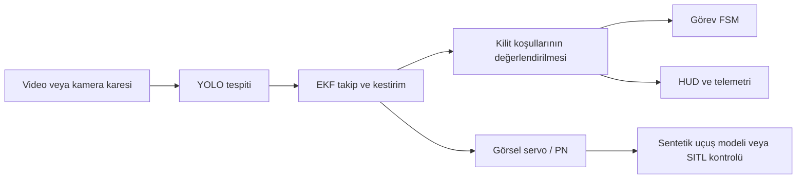

<h1 align="center">Savaşan İHA — Görsel Takip ve Kilitlenme</h1>

<p align="center">
  <strong>YOLO tabanlı algılama · EKF hedef takibi · Görsel güdüm · 4 saniyelik kilit doğrulaması</strong>
</p>

<p align="center">
  
  
  
  
</p>

Bu depo, kamera görüntüsünden başka bir İHA’yı algılayıp takip eden ve tanımlı görüntü koşullarını kesintisiz **4 saniye** sağlayınca kilit başarısı bildiren bir araştırma/prototip yazılımı içerir. Kod tabanı; çevrimdışı video demosu, etkileşimli sentetik 3D takip simülasyonu ve ROS/ArduPilot SITL’e bağlanabilen görev uygulamasından oluşur.

> [!IMPORTANT]
> Bu proje bir prototiptir. Sentetik simülasyondaki başarı gerçek araç performansını veya uçuşa hazır olmayı göstermez. Gerçek donanımda çalıştırmadan önce araç, kontrol, kamera ve emniyet yapılandırmasını yetkin bir ekip doğrulamalıdır.

## Neler var?

- **Algılama:** Ultralytics YOLO modeliyle kare veya tahmini ROI üzerinde hedef tespiti.
- **Takip:** Sabit hızlı EKF, tespit ilişkilendirme ve kısa süreli hedef kaybında coasting.
- **Güdüm:** Piksel hatasını yaw/dikey komutlara çeviren görsel servo; PN ve PID seçenekleri.
- **Kilit değerlendirmesi:** Hedef boyutu, hedef alanı, kilit alanı, kapsama, merkez sapması ve süre koşulları.
- **Görev yönetimi:** Arama, tespit, yönelme, takip, yeniden yakalama ve kilit durumlarını yöneten FSM.
- **Görselleştirme:** Kamera görüntüsü üzerine hedef kutusu, kriter listesi, durum ve kilit süresi HUD’ı.

## Veri akışı



## Hızlı başlangıç: canlı sentetik simülasyon

Bu yol Gazebo, ROS veya uçuş kontrolcüsü gerektirmez. Hedef ve avcı konumları, kamera görüntüsü ve algı kutusu simülasyon içinde üretilir.

### Kurulum

Python 3.10+ önerilir. Proje kökünde:

```powershell
py -3.11 -m venv .venv
.\.venv\Scripts\Activate.ps1
python -m pip install --upgrade pip
pip install -r requirements.txt
```

Linux/macOS sanal ortam etkinleştirme komutu:

```bash
python3 -m venv .venv
source .venv/bin/activate
python -m pip install --upgrade pip
pip install -r requirements.txt
```

### Çalıştırma

```bash
python live_simulation.py
```

Simülasyon penceresi kilit başarı ekranında durur. `Q` ile kapatın.

| Tuş | İşlev |
|---|---|
| `A` / `D` | Hedefi sola / sağa yönlendir |
| `W` / `S` | Hedefi tırmandır / alçalt |
| `Space` | Hedefin otomatik kaçışını aç / kapat |
| `R` | Başlangıç konumlarına dön ve takibi sıfırla |
| `Q` | Simülasyondan çık |

## Video demosu ve benchmark

Video demosu `Savaşan_İHA_Görevi/assets/savaşan_iha.mp4` videosunu ve `Savaşan_İHA_Görevi/models/model.pt` ağırlıklarını kullanır. YOLO ve PyTorch kurulu olmalıdır.

```bash
python demo_simulation.py
```

Benchmark, üç güdüm/hedef senaryosunun açısal hatasını ve kilit sürelerini karşılaştırır:

```bash
python benchmark_simulation.py
```

Grafik `benchmark_results.png` adıyla üretilir. Benchmark sonucu, gerçek uçuş veya yarışma performansı ölçümü değildir.

## ROS / ArduPilot SITL entegrasyonu

`Savaşan_İHA_Görevi/main.py`, konfigürasyondaki kamera topic’leri ve MAVLink bağlantı adresleri üzerinden Hunter/Prey araçlarını bağlar. ROS, kamera topic’leri, ArduPilot SITL araçları ve Gazebo ortamı önceden çalışır durumda olmalıdır.

```bash
cd Savaşan_İHA_Görevi
python main.py --help
python main.py --config config/default.yaml
```

Alternatif parametre dosyası, `--overlay` ile verilebilir; `--no-display` HUD penceresini kapatır. Ana ayarlar [`config/default.yaml`](Savaşan_İHA_Görevi/config/default.yaml) dosyasındadır:

- `camera`: görüntü boyutu, FOV ve ROS topic’leri
- `detector`: model yolu, sınıflar ve tespit eşikleri
- `tracker`: EKF gürültüleri, gating ve coasting sınırları
- `lock`: kilit boyutu, hedef alanı, kapsama, tolerans ve süre
- `control`: yaw/dikey PID, hız sınırları ve güdüm modu
- `vehicle`: MAVLink UDP adresleri ve bağlantı zaman aşımı

SITL ortamınızın kurulum adımları ArduPilot, ROS ve Gazebo sürümünüze bağlıdır. `Savaşan_İHA_Görevi/similasyon/` altında world, VTOL model tanımları ve parametre dosyası bulunur.

## Kilit koşulları

Varsayılan yapılandırma şu eşikleri kullanır:

1. Hedef boyutu en az `%5`.
2. Hedef merkezi tanımlı hedef vuruş alanında.
3. Kilit dikdörtgeninin merkezi hedef alanında.
4. Kilit dikdörtgeni hedef kutusunun en az `%90`’ını kapsıyor.
5. Merkez sapması hedef boyutunun en fazla yarısı.
6. Koşullar 4 saniye boyunca korunuyor.

`bbox_scale_factor` varsayılanı `0.80`’dir; değerlendirici boyut koşulunda ölçülen kutuyu **1.8 ile çarpar**. Bu, sentetik senaryoda dar yanal silueti telafi eden bir prototip ayarıdır; ham tespit boyutuyla değerlendirme için değeri `0.0` yapın. Gerçek/yarışma değerlendirmesinde bu telafi şartnameyle ayrıca doğrulanmalıdır.

Canlı sentetik simülasyonda avcı 16 m/s ile sınırlandırılmıştır; kaçış manevrası yapan hedef 14 m/s kullanır. Kilit sayacı başladığında sentetik yaklaşma hızı eşleştirilir ve ilk başarılı kilitte görünüm dondurulur. Bu kolaylaştırma yalnızca canlı demo senaryosuna aittir; ROS/SITL görev kodunun parametrelerini değiştirmez.

## Proje yapısı

```text
.
├── live_simulation.py                 # Etkileşimli sentetik 3D takip simülasyonu
├── demo_simulation.py                 # Kayıtlı video üzerinde algı/takip demosu
├── benchmark_simulation.py            # Senaryo karşılaştırması ve grafik
├── PROJE_RAPORU.md                    # Algoritma ve sistem raporu
├── requirements.txt
└── Savaşan_İHA_Görevi/
    ├── main.py                        # ROS / MAVLink görev uygulaması
    ├── config/default.yaml
    ├── control/                       # Araç ve güdüm denetleyicileri
    ├── perception/                    # YOLO, EKF, kilit ve yeniden yakalama
    ├── mission/                       # FSM, arama ve hedef pilotları
    ├── iol/                            # Kamera, HUD ve haberleşme
    ├── models/model.pt
    ├── similasyon/                     # Gazebo world ve VTOL modelleri
    └── assets/                         # Video ve örnek kayıtlar
```

Bu checkout’ta kamikaze/QR görevine ait ayrı bir uygulama klasörü bulunmuyor; README yalnızca mevcut Savaşan İHA takip/kilit kodunu belgeliyor.

## Lisans

Apache License 2.0 — [`LICENSE`](LICENSE).
